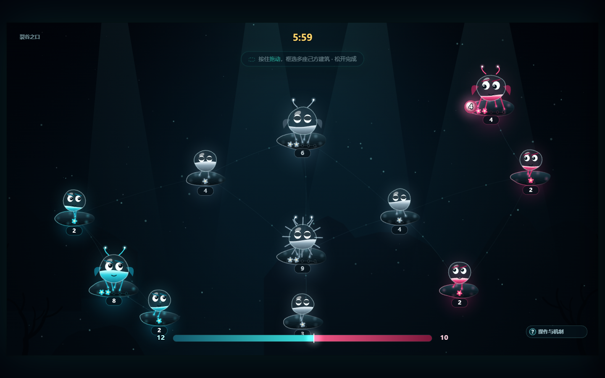
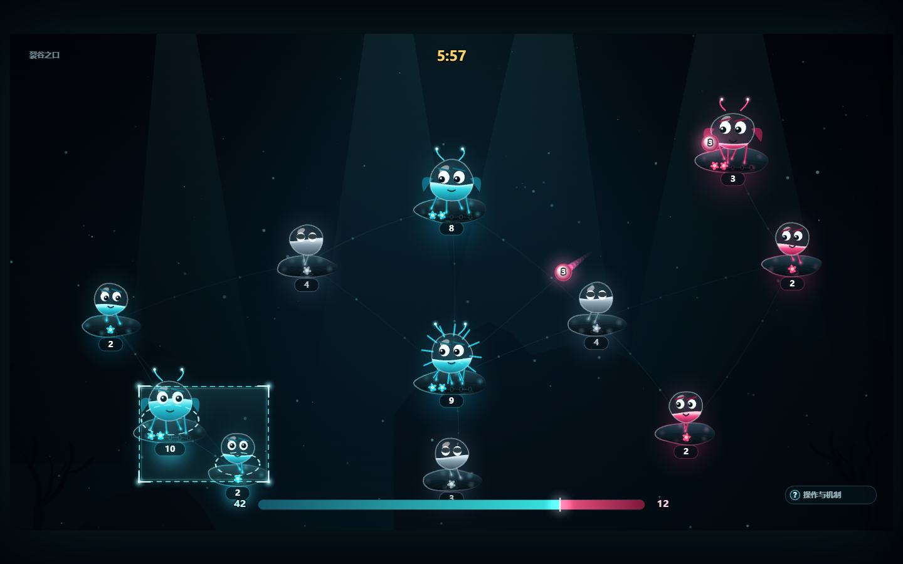
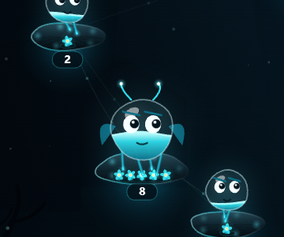
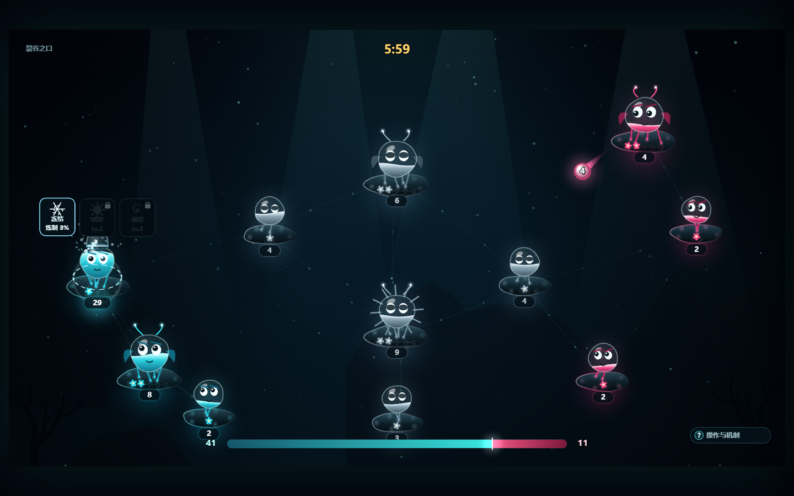
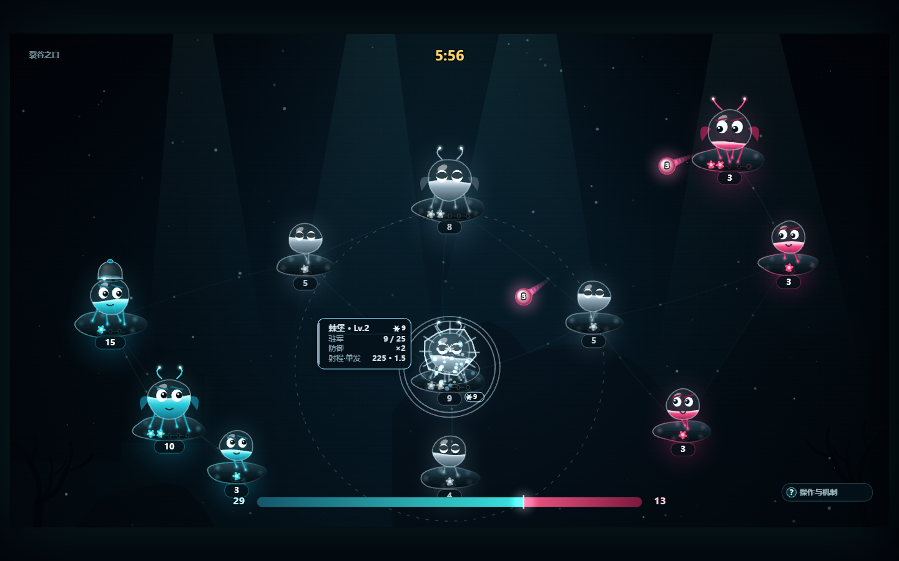
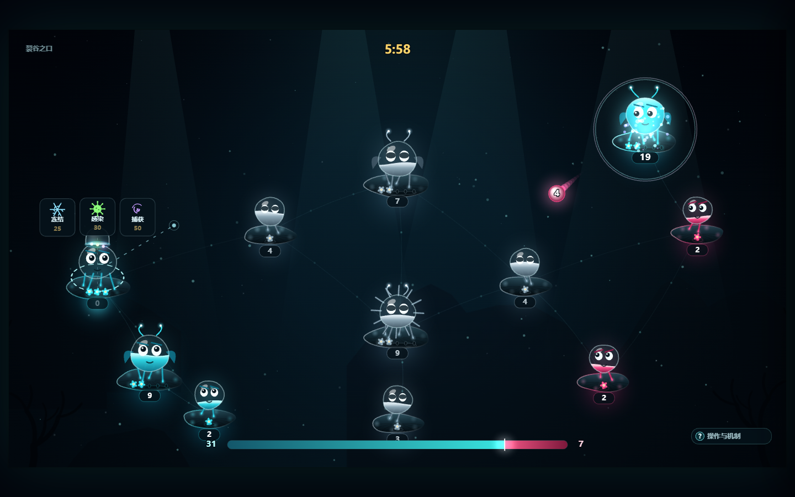
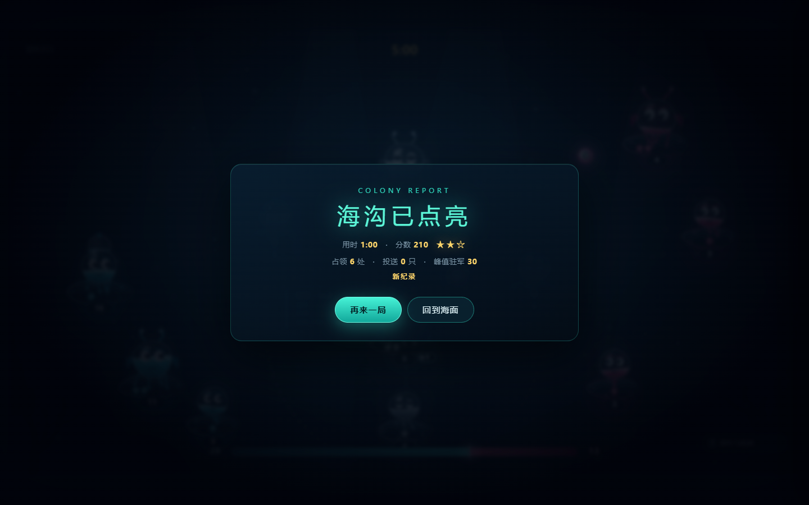
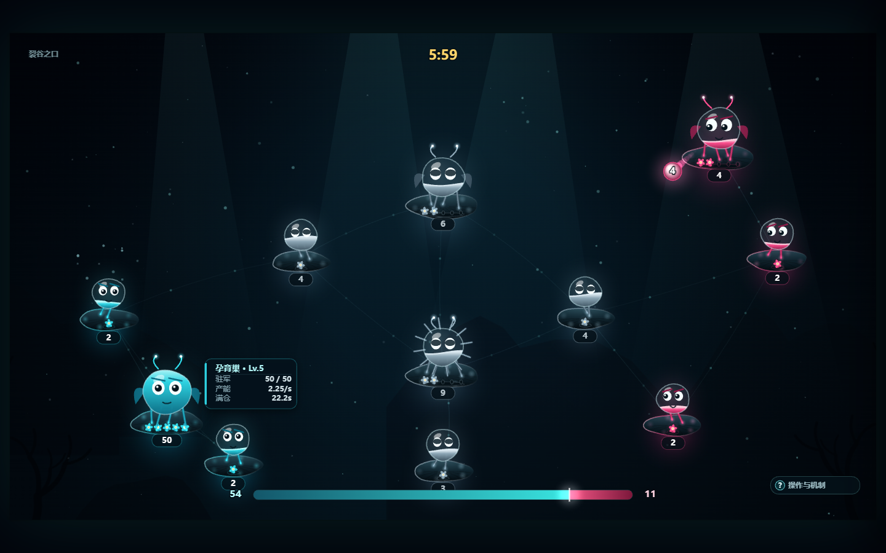
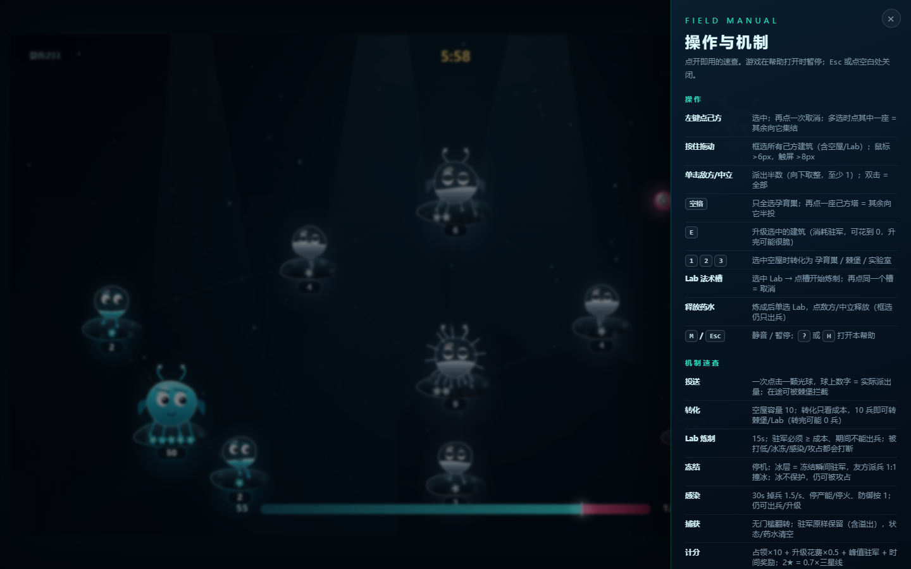
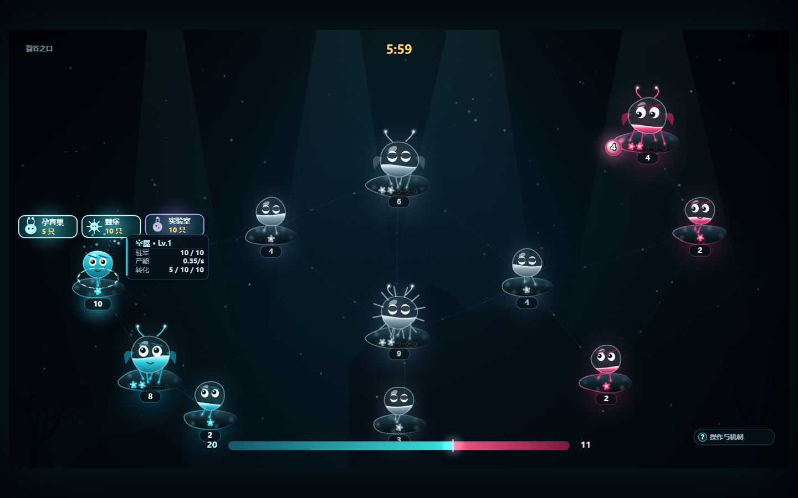

# Glowreef

> **深渊殖民地 · Abyss Colony** — M2.1（UI v1.2 / 门槛 v1.3 / 锚定 v1.5）
> 一款**深海发光生物**题材的实时领地争夺小游戏。玩法血统来自 4399《果冻勇士》(JellyGo!)，
> 美术语言完全另起一套：暗海、生物荧光、珊瑚礁盘、会看人的小生物。
> 目标：可以在个人网页上像 4399 一样点开就玩，后续接**在线 1v1** 与**双人合作打 Boss**。

> **仓库**：<https://github.com/Panini-pig/glowreef>
> **文档入口**：现行规则、数值、交互、视觉与验收以 **[设计规范.md](设计规范.md)** 为准；本文只负责快速上手、操作速查与最近一次自检。
> 《[果冻勇士(JellyGo)复刻设计基线报告.md](<果冻勇士(JellyGo)复刻设计基线报告.md>)》是原作逆向研究（v1.1 存档），**不是当前实现**。



| 框选 | 等级花苞 | Lab + 法术槽 |
|---|---|---|
|  |  |  |

| 冻结命中 | 捕获（驻军保留） | 计分三星 |
|---|---|---|
|  |  |  |

| 悬停卡（内容自适应） | 帮助抽屉 |
|---|---|
|  |  |

| 转化（10/10 三选一） |
|---|
|  |

---

## 1. 现在能玩到什么（M2.1）

| 已实现 | 说明 |
|---|---|
| 核心循环 | 孕育 → 投送 → 吞并 → 转化 → 升级，完整闭环 |
| 建筑 | 空屋 / 孕育巢（5 级）/ 棘堡（5 级，自动开火）/ **实验室 Lab（3 级）** |
| 投送 | 单击目标 = **半数**，双击 = **全部**；每次一颗光球，球上数字就是实际派出量 |
| 转化 | 选中己方空屋 → 浮出三个带图标的按钮：孕育巢（5）/ 棘堡（10）/ 实验室（10）；按 `1/2/3`；**满仓 10 即可转，转完可 0 兵** |
| 升级 | 头顶金色箭头点击升级，消耗驻军，5 级兵营 / 5 级棘堡；Lab 3 级只解锁法术 |
| 增援 | 选中己方 A，点击己方 B → 兵力合流（同样 单击半 / 双击全） |
| 战斗 | 有效伤害 = `floor(兵力 ÷ 防御)`（空屋/孕育巢/Lab 1，棘堡 2/2/3/3/4），打堡垒"亏兵"；堡垒射程内自动拦截光球 |
| **Lab 法术** | 选中 Lab → 点法术槽 → **炼制 15s**（驻军必须 ≥ 成本、期间不能出兵）→ 炼成药水 → 单选 Lab 点敌方释放 |
| **三法术** | 冻结 25（永久停机，派兵 1:1 解冻）/ 感染 30（30s、1.5/s、停火、防御按 1）/ 捕获 50（无门槛翻转，**驻军原样保留**） |
| **反制** | 打断炼制（打低驻军/冻结/感染/攻占）→ 进度清零、药水作废；冻结目标可被攻占 |
| 框选 | 按住拖动框选**所有己方建筑**（含空屋/Lab）；实时高亮、清空旧选择，鼠标与触屏都支持 |
| 等级表现 | 礁盘珊瑚花苞：亮起几朵 = 几级；空屋 1 / 孕育巢·棘堡 5 / Lab 3 |
| AI | 三档难度；M2.1 起按**经济/军事/法术三条线动态评分**，每方最多 1 座 Lab，会喂兵、炼制、释放、解冻 |
| **计分三星** | 分数 = 占领×10 + 升级花费×0.5 + 峰值驻军 + 时间奖励；结算显示星级与“本关最佳”，`localStorage` 存档 |
| **UI 规范** | 悬停卡内容自适应 136–200×74、按类型 3 行、**锚定塔正右/正左（中心上移 12px，礁盘外缘 +2px）/遮挡翻左**；右下只留 `? 操作与机制`，右侧抽屉含键位+机制；统一 UI token |
| 表现 | 生物表情/呼吸/受击/占领闪光、冰壳/菌泡、法术弹道、粒子、拖尾、选中环、出兵环、深海光柱、程序化音效 |
| 关卡 | 2 张手工地图：`裂谷之口`（对称双翼）、`黑潮回廊`（四角 + 双堡垒）；每边 2 座空屋 |
| 结算 | **点亮全图**（含中立）才算赢；6 分钟到点按总战力判定；结算给分与 1–3 星 |

**还没做**：更多关卡 + 一关一概念教学 + Boss 合作（M2.2）、在线 1v1（M3）；帽子/剧情暂不做。完整路线图见[设计规范 §10](设计规范.md#10-路线图m2--m3)。

---

## 2. 本地运行

```bash
npm install
npm run dev        # http://127.0.0.1:5173
```

生产构建与本地预览：

```bash
npm run build      # 产出 dist/（约 78 KB JS，gzip 26.2 KB）
npm run preview    # http://127.0.0.1:4173
```

> 提示：在中文路径 + Windows 下，Vite 的文件监听偶尔会因为临时文件锁报 `EBUSY`。
> 如果 `npm run dev` 崩了，用 `npm run build && npm run preview`（无监听）继续开发即可。

### Cloudflare Pages（生产部署）

仓库已按“Pages 连 Git、构建源码”准备，不需要提交 `dist/`：

| 设置 | 值 |
|---|---|
| 仓库 | `Panini-pig/glowreef` |
| 分支 | `main` |
| Build command | `npm run build` |
| Build output directory | `dist` |
| Node version | `20`（已提供 `.nvmrc`） |
| 环境变量 | 通常不需要；如控制台要指定，设 `NODE_VERSION=20` |

`vite.config.ts` 的 `base: './'` 已经保证静态资源用相对路径，部署到 Pages 根路径或子路径都可。

## 3. 操作

| 输入 | 行为 |
|---|---|
| 左键点己方建筑（无选中） | 选中 |
| 左键再点一次唯一选中的建筑 | 取消选中；多选时点其中一座 = 其余向它集结 |
| **按住拖动** | 框选：从任意位置拖出框，选中框内**所有己方建筑**（含空屋）；拖动超过 6px 才成框，松开完成 |
| 框选开始时 | **清空旧选择**（不累加），拖动过程中实时高亮；右键或 `Esc` 取消 |
| 从塔身上按住拖动 | 同样进入框选，**不会误触发出兵** |
| 在升级箭头 / 转化按钮 / 法术槽上拖动 | 不进入框选，按点击处理（保护小热区） |
| 触屏 | 单指拖动 8px 出框，轻点仍是点选 |
| 左键点己方另一处建筑 | **增援**：兵力合流（增援也算一次投送） |
| **单击**敌方 / 中立建筑 | 派出一半驻军（向下取整，至少 1） |
| **双击**敌方 / 中立建筑 | 倾巢而出，派出全部驻军 |
| 投送成功之后 | **自动取消选中**（没发出去则保留，方便直接换目标） |
| 选中任意塔 | 塔与鼠标之间有一条**跟随鼠标的直线瞄准线**；多选时整体变淡，框选时暂时收起 |
| 中立棘堡 | 白色无主棘堡**也会开火**，射程内双方路过的兵都打 |
| 塔身液面 | 按 `驻军/容量` 显示液面：下半有阵营色、上半天透明；溢出时头顶冒泡、读数牌变金 |
| AI 出兵 | 同一座塔两次出兵至少间隔 **1.8 秒**（不再每 0.9 秒连发） |
| 空格 | 只全选**孕育巢**（空屋 / 棘堡 / Lab 不选；一座都没有时空选） |
| 点击头顶金色箭头 / `E` | 升级选中建筑 |
| 选中空屋后点悬浮按钮 / `1` `2` `3` | 转化为孕育巢 / 棘堡 / **实验室** |
| **空屋 10/10** | 可直接转棘堡/实验室；只看成本 10，转完 0 兵（v1.3） |
| **选中 Lab → 点法术槽** | 开始炼制（15s）；再点同一个槽 = 取消（进度清零、不扣兵） |
| **炼制期间** | Lab 不能出兵；身体外出现药水色大环（0→360°），槽内名称下方写 `炼制 N%`；驻军必须 ≥ 成本；被打低/冻结/感染/攻占都会中断 |
| **炼成后** | 单选 Lab → 点敌方/中立 = **释放药水**（0.8s 弹道，不可拦截） |
| **框选里含就绪 Lab** | 框选只负责出兵：点敌方仍按普通投送，不会误放法术 |
| **被冻结** | 停机（不产兵/不开火/不能出兵/升级/转化）；己方派兵 **1 兵撞 1 冰** 解冻 |
| **被感染** | 30s 内掉兵 1.5/s、不产兵、不开火、防御按 1；仍可出兵/升级/转化 |
| 右键 / 点击空白 | 取消选中 |
| 空格全选后点己方某座塔 | 其余被选中的**己方建筑**向它半投（发完取消选中） |
| `M` | 静音 |
| `?` / `H` | 打开右侧“操作与机制”抽屉（游戏暂停）；`Esc` / 点空白关闭 |
| `Esc` | 暂停 |

## 4. 数值在哪调

所有平衡参数集中在三个文件，改完刷新即生效：

- `src/sim/config.ts`：建筑表（产能 / 容量 / 防御 / 射速 / 射程 / 成本）、法术表（成本/炼制/解锁）、飞行速度、对局时长、AI 难度、计分常量
- `src/sim/level.ts`：地图（节点坐标、初始归属、初始驻军、等级）、每关 par 与三星线
- `src/sim/score.ts`：计分公式、星级判定（纯函数）

**关键手感常数**（当前值；完整规则见[设计规范](设计规范.md)，原作对照见其附录 A）：

| 常数 | 当前值 | 含义 |
|---|---|---|
| `PACKET_SPEED` | 110 px/s（孕育巢 / 空屋 / Lab） | 跨 1/4 屏约 2.9 秒；棘堡出兵 ×0.62 ≈ 68 px/s，明显更慢 |
| 吞噬规则 | 只改归属与驻军 | 类型、等级原样保留（棘堡被抢走还是同级棘堡）；攻占清空状态 |
| 一次点击 | 1 颗球 | 单击 = floor(驻军/2)（至少 1），双击 = 全部；球上数字就是实际派出量 |
| 双击判定 | 220 ms | 单击延迟 220ms 出手，避免双击时先误发一半；双击的第二下用"点击瞬间的快照"，所以选中已经清掉也照样全投 |
| 防御 | 只有棘堡有：2/2/3/3/4（整数） | 伤害 = floor(兵力 ÷ 防御)。其它建筑防御恒为 1 = 来多少扣多少；**感染中的目标防御按 1** |
| 容量 | 孕育巢 10/20/30/40/50；棘堡 20/25/30/35/40；Lab 40/60/80 | 全部是 5 的倍数；自己生产只涨到容量 |
| 升级成本 | 1→2：5，2→3：10，3→4：20，4→5：30 | 与 `cost` 字段对应；Lab 1→2：15，2→3：20；**门槛 = 成本，可花到 0** |
| 炼制 | 三种法术统一 15s | 驻军锁定、不能出兵；跌破成本/被冻/被感染/被攻占 → 清零 |
| 法术成本 | 冻结 25 / 感染 30 / 捕获 50 | 炼成时从 Lab 驻军扣除；药水无限期保留 |
| 法术弹道 | 0.8s，不可拦截 | 独立于光球，棘堡不打法术 |
| 冻结 | 冰层 = 冻结瞬间驻军 | 友方派兵 1:1 撞冰；解冻兵不进驻 |
| 感染 | 30s / 1.5 兵每秒 / 防御按 1 | 共掉 45 兵；到期自动解除 |
| 计分 | 占领×10 + 升级花费×0.5 + 峰值 + max(0,(par−用时)×2) | 2★ = 0.7×三星线；L0 par 110s / 3★ 260，L1 par 140s / 3★ 340 |
| 溢出流失 | ≤5：1/s，每多 5 个 +0.2/s，上限 2/s | 外来投送可以超容量，超出部分按当前溢出量实时流失 |
| 满仓时间 | 孕育巢 10 ÷ 0.45 ≈ 22.2 s（各级一致） | 原作 25 s；当前有意加快，见规范 §2.5 |

### 一个容易被忽略的机制：溢出

自己生产**只涨到容量为止**；但**友方投送可以把它顶到容量之上**。

```
容量 20，当前 12 → 收到 15 → 27（溢出 +7）
之后每秒漏掉 1.0~2.0（按当前溢出量实时算），最终回落到 20
```

这条规则让"多打几发增援"不会白费，也不会让一个塔变成无底洞。界面上悬停该塔时会显示 `驻军 27 / 20　溢出 +7`。

## 5. 代码结构

```
src/
  sim/                 纯逻辑，无 DOM / Canvas，可直接跑在 Worker 里
    config.ts          数值表、法术表、计分常量
    types.ts           状态类型（JSON 友好）
    level.ts           关卡数据 + par/三星线
    world.ts           固定步长 tick：状态 → 生产 → 炼制 → 投送 → 法术 → 开火 → 胜负
    ai.ts              敌方 AI（三线评分 + 法术，xorshift RNG）
    score.ts           计分 / 星级纯函数
  render/              表现层，只读 sim 状态
    renderer.ts        场景编排 + HUD + 悬停卡 + 法术槽/状态挂件
    draw.ts            生物 / 礁盘 / 等级花苞 / Lab 玻璃罩 / 选择框 / 法术槽
    ui.ts              UI token（间距/字号/行高/圆角）与卡片/法术槽/帮助入口尺寸
    background.ts      深海底色、光柱、海雪（静态缓存）
    particles.ts       爆浆、冲击环、升级火花
    audio.ts           WebAudio 程序化音效（无外部资源）
  input/
    selection.ts       框选命中的纯函数（只选己方 / 中心点 / 容差）
  main.ts              引导、主循环、输入、UI 状态机、帮助抽屉、三星存档
scripts/
  sim-test.ts          逻辑层冒烟测试（不需要浏览器，24 组）
  accept-marquee.cjs   浏览器验收：框选 / 触屏 / Lab / 计分 / 悬停卡 / 帮助 / 截图（36 组）
  doc-check.ts         对照规范与 README 的自检（39 行）
  sparring.ts          脚本陪练（难度曲线）
```

**为什么这样分层**：`sim/` 之后会原封不动跑在 Cloudflare Durable Object 里做权威服务器；
`render/` 只读状态、不写状态，联机时换成"插值 + 回滚"即可。

## 6. 测试

```bash
npm run test:sim   # 逻辑层 24 组：投送/增援/越权/容量/防御/升级/胜负/AI/溢出/吞噬/中立棘堡/弹速/冷却/框选纯函数/等级槽位/Lab/炼制/冻结/感染/捕获/计分/AI 释放/门槛
```

**交付前自检（把设计规范 + README 的要求逐条变成断言）**：

```bash
node --experimental-strip-types scripts/doc-check.ts   # 对照表 + PASS/FAIL 统计（39 行）
node selfplay.cjs                                      # 我用真实鼠标事件自己打一局
DIFF=hard node selfplay.cjs                            # 换难度再打
```

浏览器端的验收脚本（需要先 `npm run dev`，默认连 5173；可用 `GAME_URL` 覆盖）：

```bash
npm run test:ui        # = node scripts/accept-marquee.cjs（36 组）
```

覆盖：首次进局提示 → 点击阈值 → 拖框实时高亮 → 松开保留 → 框选清空旧选择 →
塔身起拖不出兵 → 点空白取消 → 敌方排除 → 触屏合成拖动 → 框选后点己方塔集结 →
单击半投 / 双击全投 / 增援 / 升级箭头 / 转化按钮 → **悬停卡尺寸/帮助抽屉/帮助暂停** →
**Lab 转化/法术槽/炼制中断/炼成/释放/冻结** → **结算分数/星级/最高分存档** → 无控制台错误。
脚本同时把 `docs/screenshot.png`（自然局）、`docs/marquee.png`、`docs/level-buds.png`、
`docs/first-run.png`、`docs/title.png`、`docs/lab.png`、`docs/spell-hit.png`、`docs/result.png`、
`docs/card.png`、`docs/help.png` 截图更新掉。

两个脚本都会输出 ✓/✗ 与关键数值，方便回归。

### 难度曲线（脚本陪练，`scripts/sparring.ts`）

| 难度 | 脚本玩家胜率 | 平均时长 | 说明 |
|---|---|---|---|
| 温和 easy | **0 / 6** | 146s | 保守 AI 会囤兵；脚本不会用 Lab 破防，反而打不穿 |
| 普通 normal | **4 / 6** | 161s | 脚本能抓到正常 AI 进攻后的破绽 |
| 凶猛 hard | 0 / 6 | 73s | 目前是"打不过"的强度 |

> **这组数字不再单调**：脚本玩家不会用 Lab/法术，面对"囤兵型"的简单 AI 反而更难破局。
> 它只用于回归 AI 行为，不作为人类难度结论；M2.1 的难度请以真人用 Lab 破防后的对局为准（规范 §7.4 / §11.3）。

### 最近一次自检结果（2026-11-02）

| 检查 | 结果 |
|---|---|
| `npm run test:sim` | **24 组 / 全过**（半投/全投、增援、越权、容量、整数防御、溢出流失、吞噬保值、中立棘堡开火、弹速分档、胜负、AI 对局、框选纯函数、等级槽位、Lab 转化、炼制/中断/扣兵、冻结/解冻、感染、捕获、计分、AI 释放、转化/升级门槛） |
| `npm run test:ui` | **36 组 / 全过**（首次提示、点击阈值、框选、清空旧选择、塔身起拖不出兵、点空白、敌方排除、触屏、框选后集结、单击半投/双击全投/增援/升级/转化、**10/10 转棘堡**、悬停卡尺寸/锚定/右侧出屏翻左、`?` 帮助抽屉/暂停、Lab 转化、法术槽、炼制中断/炼成、释放冻结、结算星级/存档、无控制台错误） |
| `node --experimental-strip-types scripts/doc-check.ts` | **PASS 30 · FAIL 0 · PARTIAL 1 · MANUAL 7 · TODO 1**（39 行） |
| `node selfplay.cjs` | 用真实鼠标事件完整跑一局（选中/转化/升级/半投/结算），**无控制台错误**；脚本本身打得不好，胜负不作为难度依据（难度看上面的 sparring） |
| `node --experimental-strip-types scripts/sparring.ts` | 脚本陪练：easy 0/6、normal 4/6、hard 0/6（脚本不会用 Lab，数字不单调，见上） |

> TODO 项现在是 M2.2 的“75 关 + 一关一概念教学”，不是缺陷；当前优先级见[设计规范 §10](设计规范.md#10-路线图m2--m3)。

## 7. 部署到 Cloudflare Pages

**方式 A（推荐，Git 直连）**

1. 把仓库推到 GitHub；
2. Cloudflare Dashboard → Workers & Pages → Create → Pages → Connect to Git；
3. 构建设置：
   - Framework preset：`Vite`
   - Build command：`npm run build`
   - Build output directory：`dist`
4. 保存后每次 push 自动部署，域名形如 `https://<project>.pages.dev`。

**方式 B（本地直传）**

```bash
npx wrangler pages deploy dist --project-name abyss-colony
```

> `vite.config.ts` 里已设 `base: './'`，所以部署在子路径（`/games/abyss/`）也不会白屏。

## 8. 联机路线（M3）

目标两种模式：**1v1 对抗** 与 **双人合作打 Boss**。两者共用一套"权威服务器 + 指令流"。

```
客户端                       Cloudflare
┌──────────┐   输入指令     ┌───────────────────┐
│ 本地 sim │ ───────────▶  │ Durable Object     │
│（预测）  │               │  · 房间状态        │
│          │ ◀───────────  │  · 30Hz 模拟       │
└──────────┘  10–20Hz 快照  │  · 反作弊校验      │
                           └───────────────────┘
```

**房间即 Durable Object**：`Room` 类持有 `World`，以 **30 Hz** 跑 `tick`（和客户端同一个固定步长），
广播 **10–20 Hz** 的 `{tick, deltas}` 快照；客户端把本地未确认的出兵动画做"预测播放"，收到快照后校正数字。

**必须现在就守住的约束**（否则联机要返工）：

1. `sim/` 里不能有 `Date.now()`、`Math.random()`、DOM 引用 —— 现在已满足；
2. 兵力用整数（当前是浮点产能，联机时改成 `1/100` 定点）；
3. 光球 id 改为 world 内计数器（当前 `world.ts` 的 `uid` 是模块级自增）；
4. 所有操作走 `issueSend / upgradeBuilding / convertBuilding / startBrew / cancelBrew / releaseSpell` 六个入口 —— 正好是天然的"指令集"。

**Boss 合作模式**：Boss 复用 `building.type = 'boss'`（产能 10/s、容量 300、防御 2），
两名玩家共享"蓝色"阵营但各自持有独立巢穴，胜负条件从"清空对手"改为"打掉 Boss 核心"。

## 9. 与 4399 原作的差异（有意为之）

| 维度 | 原作 | 本作 |
|---|---|---|
| 题材 | 糖果色软体果冻 | 深海发光生物（暗海 + 生物荧光） |
| 数字 | 印在果冻肚子上 | ① 据点读数牌（不挡脸）② 投送光球上的运兵数 |
| 转化 | 建筑上点击 | 建筑附近悬浮按钮（带目标形态图标，自动避让） |
| 输入 | 点选 / 双击 / 空格 / 箭头 | 追加**拖拽框选**；点击改到松开结算；法术槽/释放 |
| 等级 | 体型 / 箭头 | 礁盘**珊瑚花苞**，亮几朵 = 几级 |
| 法术 | 快速弹道 + 计时效果 | **15s 炼制 + 药水 + 手动释放**；冻结永久/感染 30s/捕获无门槛且保留驻军 |
| 节奏 | 35 FPS / 50 px·s⁻¹ | 30 Hz 逻辑 / **110 px·s⁻¹**（棘堡 68.2）；法术 0.8s |
| 结算 | 计分 + 三星 | **四项可解释公式 + 三星 + 最高分存档** |
| 建筑线 | 兵营 / 堡垒 / 实验室 | 三条都做（Lab 3 级，Lv.1/2/3 解锁三法术） |
| 关卡 | 75 关 | 2 张手工图 |

设计依据与完整数值溯源：现行规则见 **[设计规范.md](设计规范.md)**；原作研究见
《[果冻勇士(JellyGo)复刻设计基线报告.md](<果冻勇士(JellyGo)复刻设计基线报告.md>)》（v1.1 存档，**非当前实现**）。

---

## 10. 已知限制

- 只有三星最高分存档：刷新后星级还在，但没有完整对局存档/关卡选择；
- AI 对局偶尔会拖到 6 分钟由战力判定；M2.1 已补 Lab 破防，但 AI 的喂养/炼制节奏仍需调；
- 冻结是永久停机 + 派兵解冻，大据点可能凑不出解冻兵；捕获无门槛且保留驻军，50 兵换满级棘堡可能过强——两条都待实测平衡（规范 §11.3）；
- 三星线是首版手填值（L0 260 / L1 340），需要真人对局校准；
- 转化/升级现在**可以花到 0 兵且不弹提醒**；新手可能把塔升空后被抢（规范 §11.3 #16）；
- 自玩脚本在 1000×700 无头环境跑（软件渲染约 20 FPS），换 GPU 会更快；
- Boss 关、一关一概念教学、帽子尚未实现；
- 音效是程序化合成的占位，正式版建议换成采样；
- 触屏可用（单指拖动也能框选，法术槽在单选 Lab 时可用），但没有专属移动端布局；**触屏升级箭头依赖 hover，可能不出现**（已知缺口，见规范 §11.3）；
- UI token 目前只覆盖悬停卡/法术槽/状态/帮助入口；读数牌、转化按钮、底部长条、标题/结算面板仍是旧数值（规范 §11.3 #14）；
- 光球 id 是模块级自增、棘堡伤害会让光球余量出现小数——只影响表现/联机前需统一，见规范 §8.4。

---

## 11. License

代码以 **MIT License** 开源，见 [LICENSE](LICENSE)。

《果冻勇士(JellyGo)复刻设计基线报告.md》是原作逆向研究存档，仅用于设计考证；原作名称、素材与商标归其各自权利人所有，本项目不包含原作素材。
